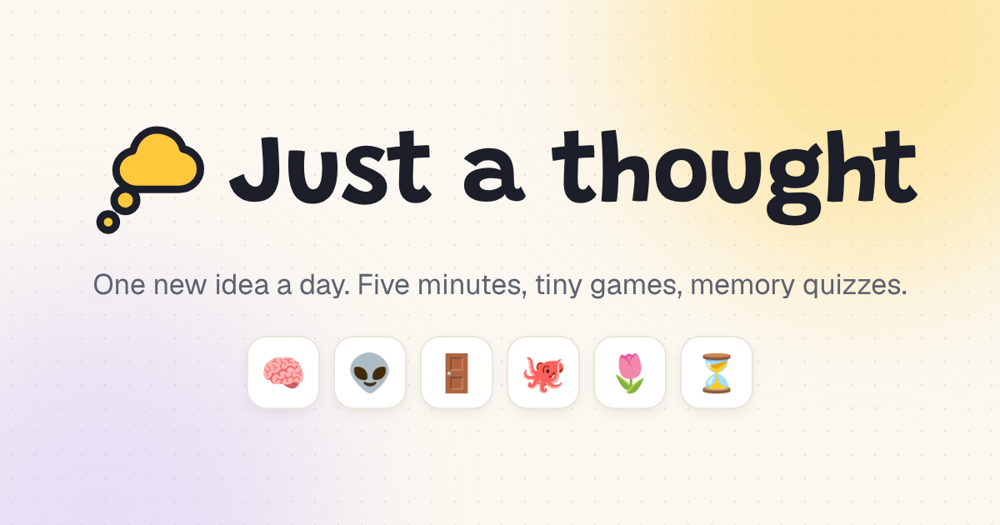

# Just a thought



One new idea every day, learned in a few minutes. Read a short explanation, flip a few fact cards, play two or three tiny games, and walk away knowing something new. Sign in to keep a streak, and after 7 thoughts, memory quizzes unlock that mix questions from everything you've learned.

Topics span science, space, history, philosophy, ethics, ideologies, experiments, research and curious facts.

## Features

- **One thought a day.** Everyone gets the same thought, and only today's can be played. A new one arrives at midnight in your own time zone.
- **Six mini games:** multiple choice, swipe true/false, drag into order, match pairs, guess the number on a slider, and opinion polls that show how other players voted (once a poll has 10 votes).
- **Library** of every thought you've learned, with your streak. Missing one day is forgiven; two in a row end the streak.
- **Past thoughts** at `/thoughts`: every thought whose day is over gets a public page to read (not play). Good for people who missed a day, and for search engines.
- **Memory quizzes** unlock after 7 thoughts and pull from all of them, because recalling is how memories stick. Scores are saved, and the result screen shows your last few.
- **Passwordless sign-in** with a 6-digit email code, or Google. Guests can play, their result is remembered in the browser, and it's saved to their account when they sign up.
- **Share** today's thought and score from the finish screen. Shared links show a card with that day's thought (`src/lib/og.tsx`).
- **Light and dark mode** with a switch in the header (follows the device until you choose), and lots of small animations (respecting reduced motion).
- **Account deletion** and a plain-language privacy page.

## Tech

[Next.js 16](https://nextjs.org) (App Router, Cache Components), [Better Auth](https://better-auth.com), [Drizzle ORM](https://orm.drizzle.team) on Postgres, [Tailwind CSS v4](https://tailwindcss.com), [shadcn/ui](https://ui.shadcn.com), [Motion](https://motion.dev), [Resend](https://resend.com) for email and [Vercel Web Analytics](https://vercel.com/docs/analytics) for visit counts. To see the numbers, enable Analytics in the Vercel project.

## Run it locally

You need Node.js 22 or newer and a Postgres database (a free [Neon](https://neon.tech) database works, or a local one).

```bash
npm install
cp .env.example .env   # set DATABASE_URL and BETTER_AUTH_SECRET
npm run db:migrate     # create the tables
npm run dev            # http://localhost:3000
```

Sign-in codes are printed in the terminal running `npm run dev`, so you don't need an email service locally.

Without a database you can still play today's thought as a guest, and browse every thought at [`/preview`](http://localhost:3000/preview).

## Deploy to Vercel with Neon

1. Import the GitHub repo into [Vercel](https://vercel.com/new).
2. In the Vercel project, open **Storage** and connect a **Neon** database. This sets `DATABASE_URL` for you.
3. Add the other environment variables below under **Settings → Environment Variables**.
4. Deploy. Every build first runs the database migrations, so the tables are created and kept up to date automatically.

Server code runs in Frankfurt (`fra1`, set in [`vercel.json`](vercel.json)) to sit next to the Neon database. If your database is elsewhere, change the region to match, or every page waits on a long round trip.

### Environment variables

| Variable | Needed | What it is |
| --- | --- | --- |
| `DATABASE_URL` | Yes | Postgres connection string. Set automatically by the Neon integration. |
| `BETTER_AUTH_SECRET` | Yes | A random string of 32+ characters. Generate one with `openssl rand -base64 32`. |
| `BETTER_AUTH_URL` | Yes | The public URL of the app, e.g. `https://justathought.day`. Also used for canonical links and the sitemap. |
| `RESEND_API_KEY` | In production | API key from [Resend](https://resend.com), used to email sign-in codes. |
| `EMAIL_FROM` | In production | Sender, e.g. `Just a thought <hello@yourdomain.com>`, on a domain verified in Resend. Also shown as the contact address on `/privacy`. |
| `GOOGLE_CLIENT_ID` | Optional | Enables "Continue with Google". |
| `GOOGLE_CLIENT_SECRET` | Optional | Goes with the client ID. In Google Cloud, add `<BETTER_AUTH_URL>/api/auth/callback/google` as a redirect URI. |

If sign-in codes don't arrive, check the Vercel logs for `Failed to run background task`. Email errors are logged there rather than shown to the user.

## How the days work

- `LAUNCH_DATE` in [`src/content/index.ts`](src/content/index.ts) is the day thought #1 goes live. **Set it to your real launch day.**
- Days follow each player's local time. The browser saves its time zone in a `tz` cookie. Before that cookie exists, the server uses Vercel's guess from the IP address, then UTC.
- Each next thought in the `thoughts` array unlocks one day later.
- Only today's thought can be played. Someone mid-play at midnight can still save yesterday's thought for one hour.
- If the list runs out, the home page shows "No new thought today", so keep a buffer of thoughts ready.

## Writing new thoughts

Each thought is one file in [`src/content/thoughts/`](src/content/thoughts). The shape is defined in [`src/content/types.ts`](src/content/types.ts).

1. Copy an existing thought file and rewrite it.
2. Add it to the **end** of the `thoughts` array in [`src/content/index.ts`](src/content/index.ts).
3. Play it at [`/preview`](http://localhost:3000/preview) in `npm run dev`. Nothing is saved there.

A thought has a title, emoji, category, a one-line hook, 2 or 3 short paragraphs (wrap key words in `**double stars**`), a one-sentence takeaway, 3 flip-card facts, 2 or 3 games and 3 recall questions for the memory quizzes.

| Game type | What the player does | Scored |
| --- | --- | --- |
| `choice` | Picks one answer | Yes |
| `truefalse` | Swipes statements left or right | Yes |
| `order` | Drags items into the right order | Yes, per position |
| `match` | Taps pairs together | Yes, minus wrong guesses |
| `estimate` | Guesses a number on a slider | Yes, within a tolerance |
| `poll` | Gives an opinion, then sees what share of players chose each option | No |

Content is checked automatically. A mistake like an answer pointing past the options, or two thoughts from the same category on back-to-back days, shows an error in `npm run dev` and fails the build, naming the thought and the problem.

**Rules:** once a thought is live, never rename its `slug`, move it in the list, or reorder its games or poll options. Progress is stored by slug, the schedule follows the list order, and poll votes are stored by position.

## Changing the database

Edit [`src/db/schema.ts`](src/db/schema.ts), then run:

```bash
npm run db:generate   # writes a new migration file to ./drizzle
npm run db:migrate    # applies it to your local database
```

Commit the new file in `./drizzle`. The next deploy applies it to production automatically.

## Testing

- `npm test` runs quick checks: every thought passes the content rules in schedule order, answers aren't usually the longest option, days follow each player's time zone, and streaks forgive one missed day.
- `npm run test:e2e` plays today's thought in a real browser against `http://localhost:3000` (start the app first). `BASE_URL=https://justathought.day SIGNUP=1 npm run test:e2e` also signs up with a throwaway inbox, checks the signed-in pages and deletes the account. Poll votes are never counted.
- GitHub Actions runs lint, types, `npm test`, a build and the browser test on every push ([`ci.yml`](.github/workflows/ci.yml)), and checks the live site every morning ([`live-check.yml`](.github/workflows/live-check.yml)).

## Scripts

| Command | What it does |
| --- | --- |
| `npm run dev` | Start the dev server |
| `npm run build` | Run database migrations (if `DATABASE_URL` is set), then build |
| `npm run start` | Serve the production build |
| `npm run lint` | Lint the code |
| `npm test` | Content, day and streak checks |
| `npm run test:e2e` | Play today's thought in a browser |
| `npm run db:migrate` | Apply pending migrations |
| `npm run db:generate` | Create a migration after changing the schema |
| `npm run db:studio` | Browse the database in Drizzle Studio |

## Project structure

```
src/
  app/                 pages: / (today), /thoughts (past), /library, /review, /account, /privacy, /sign-in, /preview
    robots.ts, sitemap.ts  search engine files; only the production deployment is indexable
    actions.ts         saving a learned thought, deleting an account
  components/
    player/            the daily flow and the six mini games
    quiz/              memory quizzes
    ui/                shadcn/ui components
  content/
    thoughts/          one file per thought
    index.ts           the schedule and LAUNCH_DATE
    validate.ts        the content checker
  db/schema.ts         database tables
  lib/                 auth, email, data access
drizzle/               database migrations
scripts/migrate.mjs    runs migrations before each build
```
